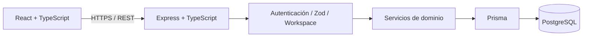

# Cifrya — estudio de caso de ingeniería

**Producto:** plataforma de finanzas personales en desarrollo · **Rol:** desarrollo full stack del proyecto personal · **Demo:** https://cifrya.com/demo

## Problema que intenté resolver

Un mismo usuario puede tener varias cuentas, realizar movimientos y transferencias y revisar presupuestos u obligaciones. Si cada pantalla calcula saldos por su cuenta, aparecen resultados diferentes. El objetivo técnico fue mantener **reglas financieras coherentes entre el cliente y la API**, sin mezclar datos de diferentes espacios de trabajo.

## Arquitectura y decisiones

- **Monolito modular:** separamos módulos de cuentas, movimientos, presupuestos, autenticación y otros dominios, sin distribuir prematuramente la solución en microservicios.
- **Datos monetarios:** Prisma/PostgreSQL usan importes decimales, evitando cálculos financieros con `float`.
- **Separación de responsabilidades:** el servidor concentra validación, permisos, reglas financieras y persistencia; el frontend presenta estados, formularios y respuestas de la API.
- **Aislamiento:** las operaciones con información financiera se vinculan al espacio de trabajo del usuario.
- **Autenticación:** tokens de acceso y renovación, revocación de sesiones y cookies protegidas en los flujos correspondientes.

## Ejemplo concreto: consistencia al registrar una transferencia

Una transferencia afecta por lo menos dos cuentas. Registrar únicamente la salida sin la entrada, o repetir una solicitud que ya se ejecutó, puede crear un saldo incorrecto.

Por eso, en el diseño del backend prioricé:

1. **Validar** importe, cuentas de origen y destino y pertenencia al espacio de trabajo antes de persistir.
2. **Representar** los importes con tipos decimales y reglas de dominio en el servidor, no con sumas independientes en React.
3. **Agrupar** cambios relacionados dentro de transacciones de la base de datos, para que no se confirmen de forma parcial.
4. **Controlar** rutas protegidas y errores antes de devolver un estado definitivo al cliente.
5. **Probar** operaciones y escenarios relevantes con unitarias, integración en PostgreSQL aislado y recorridos end-to-end.

**Límite de la evidencia:** este documento explica el enfoque de arquitectura y las garantías buscadas, pero no reproduce código privado ni constituye una auditoría externa de todas las operaciones financieras. No atribuyo métricas de tráfico, ventas, rendimiento o ahorro que no se hayan medido.

## Pruebas y CI

La cuenta oficial de Cifrya usa GitHub Actions para verificar lint, tipos, pruebas unitarias, build y pruebas de integración del backend en una base de QA. El frontend oficial tiene recorridos E2E con Playwright y el backend controles de disponibilidad contra los servicios desplegados.

Los repositorios oficiales son privados; la demo está abierta al público. Puedo explicar las decisiones y los casos de fallo en una entrevista técnica sin compartir credenciales ni datos personales.

## Tecnologías

React, TypeScript, Vite, TanStack Query, Zod, Node.js, Express, Prisma, PostgreSQL, Vitest, Supertest, Playwright, GitHub Actions, Vercel, Render y Neon.

## Qué haría después

- Incrementar las pruebas para reintentos, concurrencia y reversión de operaciones con datos de prueba.
- Revisar rendimiento de consultas frecuentes antes de introducir optimizaciones innecesarias.
- Mantener una ruta clara de migraciones de base de datos, revisión de seguridad y documentación de contratos API.
